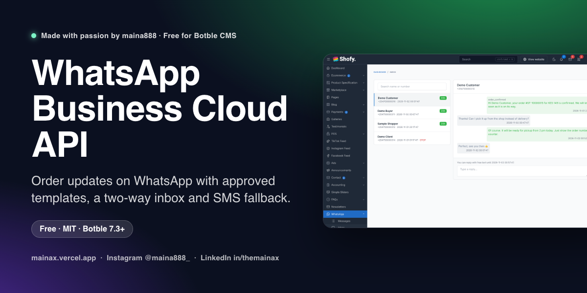
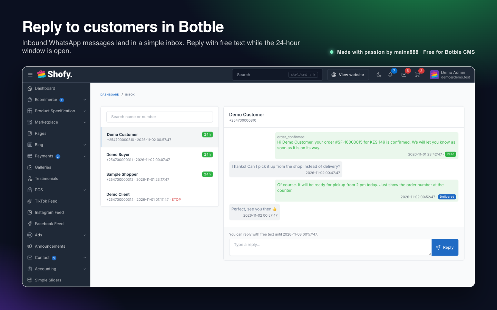
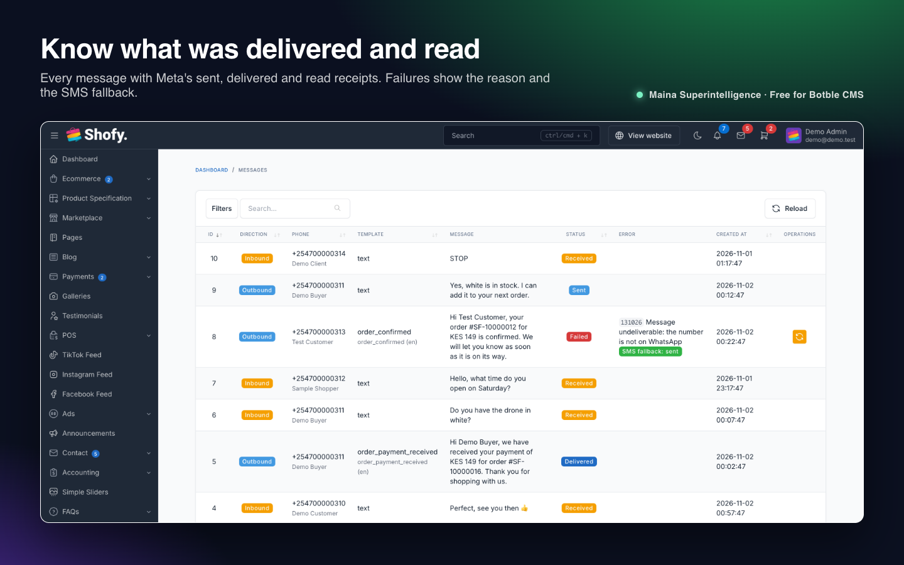
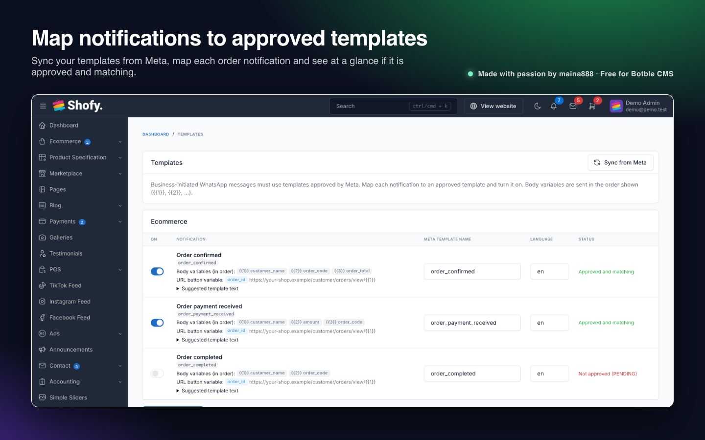
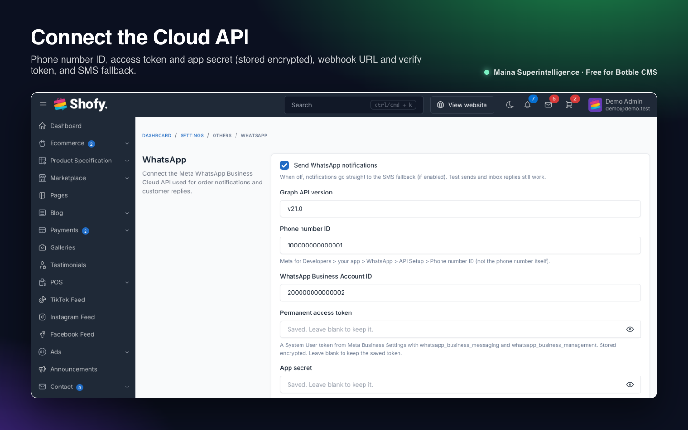

Send order updates over WhatsApp with the official Meta WhatsApp Business Cloud API, and answer customers from a simple inbox inside Botble. Delivery and read receipts, STOP/START opt-out and an optional SMS fallback are built in.

**Free and open source** by **Maina 888** · Maina Superintelligence Ltd

**Version:** 1.1.0 · **Requires:** Botble CMS core 7.3.0+, PHP 8.2+ · **License:** MIT

## Features

- **Order notifications on WhatsApp:** *Order confirmed*, *Order payment received* and *Order completed*, each mapped to a template approved by Meta, with an optional "View order" URL button. Each order gets each message once.
- **Templates page:** sync your templates from Meta, map each notification to a template and language, switch it on, and see at a glance whether the template is approved and has the right number of variables. Suggested template text is included for each notification.
- **Inbox:** inbound messages appear as conversations. Reply with free text while WhatsApp's 24-hour customer service window is open.
- **Message log** with direction, template, text, Meta's sent / delivered / read / failed status, the error code and reason, and a **Resend** button for failed messages.
- **Contacts** with opt-out status. Customers who reply **STOP** are opted out automatically (and back in with **START**), with an optional confirmation message. You can also toggle it by hand.
- **SMS fallback:** if a WhatsApp message can't be delivered (not on WhatsApp, opted out, template rejected, WhatsApp switched off), send it as SMS through the free **SMS via Africa's Talking** plugin. Optional; only used when that plugin is active.
- **Send test page** and `whatsapp:send-test` command, using Meta's built-in `hello_world` template.
- **Secure webhook:** the verification handshake uses your verify token, and every webhook POST is checked against Meta's `X-Hub-Signature-256` signature. Access token and app secret are stored encrypted.
- **Reliable sending:** messages go through Laravel's queue, with retries and backoff for rate limits and temporary Meta errors.
- **Dashboard widget** with today's sent, delivered, read, failed and received counts.
- **Developer API:** `whatsapp_send_template()`, `whatsapp_send_text()`, a `whatsapp_templates` filter for your own notifications, and events for sent, failed, received, status changes and opt-outs.

## Screenshots

| Inbox | Messages |
| --- | --- |
|  |  |
|  |  |

## Requirements

- Botble CMS core 7.3.0 or newer, PHP 8.2 or newer.
- A Meta WhatsApp Business account with the WhatsApp product added to a Meta app, a phone number on the Cloud API, and a permanent (System User) access token.
- A site reachable over **HTTPS** for the webhook (receipts, inbox and opt-outs). Sending works without it.
- Optional: the **Ecommerce** plugin for order notifications; the **SMS via Africa's Talking** plugin for the SMS fallback.
- Recommended: a queue worker (`php artisan queue:work`). Without one, messages are sent during the request and failures are not retried.

## Installation

### From the Botble Marketplace (recommended)

1. Go to **Admin → Plugins → Add new**.
2. Search for **WhatsApp Business Cloud API**, click **Install**, then **Activate**.

Updates appear in **Admin → Plugins** whenever a new version is released.

### From a release zip

1. Download `whatsapp-x.y.z.zip` from the [latest release](https://github.com/Themaina/maina-whatsapp/releases/latest).
2. Go to **Admin → Plugins → Add new → Upload**, pick the zip, then **Activate**.

### Manually

1. Copy the `whatsapp` folder to `platform/plugins/whatsapp`.
2. Run `php artisan cms:plugin:activate whatsapp`. Activation creates the `whatsapp_contacts`, `whatsapp_messages` and `whatsapp_templates` tables and a random webhook verify token.

## Configuration

### 1. Meta setup

1. In [Meta Business Settings](https://business.facebook.com) verify your business and create a WhatsApp Business Account.
2. In [Meta for Developers](https://developers.facebook.com) create an app of type *Business*, add the *WhatsApp* product and add your phone number. The number can't be in use on the WhatsApp or WhatsApp Business phone app at the same time.
3. Under *Business Settings → System users*, create a system user, give it the app and the WhatsApp account, and generate a token with `whatsapp_business_messaging` and `whatsapp_business_management` that never expires.
4. Copy the *Phone number ID* and *WhatsApp Business Account ID* from *WhatsApp → API Setup*, and the *App secret* from *App settings → Basic*.
5. Add a payment method in WhatsApp Manager (business-initiated messages are billed by Meta).

### 2. Plugin settings

Open **Admin → Settings → Others → WhatsApp** (also under **WhatsApp → Settings**).

| Setting | What it does |
| --- | --- |
| Send WhatsApp notifications | Master switch for notifications. Test sends and inbox replies still work when it is off. |
| Graph API version | Default `v21.0`. |
| Phone number ID / WhatsApp Business Account ID | From *WhatsApp → API Setup*. |
| Permanent access token / App secret | Stored encrypted. Leave blank to keep the saved value. The app secret is used to verify webhook signatures. |
| Webhook verify token | Any random string (one is generated on activation). Paste the same value into Meta. |
| Webhook callback URL | Shown on the page with a copy button: `https://your-shop.example/whatsapp/webhook`. |
| Default template language | Meta language code of your templates, e.g. `en`, `en_US`. |
| Default country code | Added to local numbers such as `07XX XXX XXX`. Empty uses your store country; otherwise numbers must be international. |
| Fall back to SMS | Send undeliverable notifications as SMS through the SMS via Africa's Talking plugin (when it is active). |
| Reply to STOP / START | Send a short confirmation when a customer opts out or back in. |

### 3. Webhook

In Meta, open *WhatsApp → Configuration → Webhook*, paste the callback URL and the verify token, click *Verify and save*, then **subscribe to the `messages` field**.

### 4. Templates

1. Create your templates in WhatsApp Manager (category *Utility*). The **Templates** page shows suggested text for each notification and the order of its variables (`{{1}}`, `{{2}}`, …).
2. When Meta has approved them, click **Sync from Meta**.
3. For each notification enter the Meta template name and language, switch it on and click **Save mapping**. The status column tells you if something doesn't match.
4. Use **WhatsApp → Send test** to send `hello_world` or one of your notifications with sample values to your own phone.

## Usage

### Admin pages

| Page | Purpose |
| --- | --- |
| **WhatsApp → Messages** | All inbound and outbound messages with status and errors; resend failed ones. |
| **WhatsApp → Inbox** | Conversations; reply while the 24-hour window is open. |
| **WhatsApp → Contacts** | Everyone you've messaged or who wrote to you, linked to the customer when the number matches; toggle opt-out. |
| **WhatsApp → Templates** | Sync from Meta and map notifications to templates. |
| **WhatsApp → Send test** | Check the connection. |

### Routes

| URL | Purpose |
| --- | --- |
| `GET /whatsapp/webhook` | Meta's verification handshake (`hub.verify_token` must match). |
| `POST /whatsapp/webhook` | Status updates and inbound messages. Requests without a valid `X-Hub-Signature-256` get 403. |

### Commands

| Command | What it does |
| --- | --- |
| `php artisan whatsapp:sync-templates` | Fetches your templates from Meta (same as the button). |
| `php artisan whatsapp:send-test {phone} --template=hello_world --language=en_US` | Sends a test template. |

### From your own code

```php
// Register a notification; it appears on the Templates page to be mapped and switched on.
add_filter('whatsapp_templates', function (array $templates): array {
    $templates['order_shipped'] = [
        'label' => 'Order shipped',
        'group' => 'Shipping',
        'template_name' => 'order_shipped',                               // suggested Meta template name
        'variables' => ['customer_name', 'order_code', 'tracking_id'],    // body {{1}}, {{2}}, {{3}}
        'preview' => 'Hi {{customer_name}}, order {{order_code}} is on its way (tracking {{tracking_id}}).',
    ];

    return $templates;
}, 30);

// Queue it. Falls back to SMS (if enabled and the SMS plugin is active) when it can't be delivered.
whatsapp_send_template('+2547XXXXXXXX', 'order_shipped', [
    'customer_name' => 'Demo Customer', 'order_code' => '#10000012', 'tracking_id' => 'TRK123',
], ['related' => $order]);

// Free text, only within 24 hours of the customer's last message.
whatsapp_send_text('+2547XXXXXXXX', 'Your order is ready for pickup.');
```

Context keys you can pass: `related` (a model), `customer_id`, `name`, `fallback_sms` (true/false to force or suppress the fallback), `sms_message` (exact SMS text), `urgent` (passed to the SMS plugin), `template_name` / `language` (override the mapping). Events: `WhatsappMessageSent`, `WhatsappMessageFailed`, `WhatsappMessageReceived`, `WhatsappMessageStatusUpdated`, `WhatsappContactOptedOut` in `MainaSuperintelligence\Whatsapp\Events`.

Advanced options (retries, backoff, queue name, opt-out keywords, 24-hour window) are in `config/general.php`; publish it to `config/plugins/whatsapp/general.php` to change them.

## How it works

Each outgoing message is stored in `whatsapp_messages` and sent by a queued job to `POST /{phone-number-id}/messages` on the Graph API. Temporary errors (rate limits, Meta outages) are retried with backoff; permanent errors mark the message failed and, if allowed, hand it to the SMS plugin. Meta's webhook then reports *sent*, *delivered*, *read* or *failed* for each message (never moving a message backwards), and delivers inbound messages, which open the 24-hour window for free-text replies and handle STOP/START.

The built-in order notifications don't fall back to SMS, because the SMS via Africa's Talking plugin already sends its own order messages for the same events. Turn on only the channel you want for each event.

## Troubleshooting

| Problem | Fix |
| --- | --- |
| Messages fail with *template_disabled* or *template_not_mapped* | Map the notification on the Templates page, switch it on and save. |
| Meta error `132001` (template does not exist) | The template name or language doesn't match an approved template. Sync and check the status column. |
| Meta error `131026` (undeliverable) | The number isn't on WhatsApp. Turn on the SMS fallback. |
| Meta error `190` | The access token expired or lacks permissions. Use a System User token that never expires. |
| No receipts or inbox messages | Check the webhook is verified and subscribed to `messages`, the app secret is saved (otherwise every POST is rejected with 403), and the site is on HTTPS. |
| Can't reply in the inbox | The 24-hour window is closed. Wait for the customer to write again, or send a template. |
| SMS fallback shows *unavailable* | Install and activate the SMS via Africa's Talking plugin. |

## Uninstall

Remove the plugin from **Admin → Plugins**. The `whatsapp_contacts`, `whatsapp_messages` and `whatsapp_templates` tables and all `whatsapp_*` settings are deleted.

## Development

Unit tests (phone numbers, webhook signatures) only need the Botble project's vendor directory:

```bash
vendor/bin/phpunit -c platform/plugins/whatsapp/phpunit.xml.dist
```

Feature tests boot the application against the database in `.env`, run inside rolled-back transactions with the Graph API faked, and need `mockery/mockery`. Run them on a development copy only:

```bash
vendor/bin/phpunit -c platform/plugins/whatsapp/phpunit.xml.dist --testsuite=Feature
```

## File structure

```
whatsapp/
├── plugin.json
├── config/{general.php, permissions.php}
├── database/migrations/
├── helpers/helpers.php
├── routes/web.php
├── resources/{lang/en, views}
├── src/{Commands, Enums, Events, Exceptions, Forms, Http, Jobs, Listeners, Models, Providers, Services, Supports, Tables, Plugin.php}
├── tests/{Unit, Feature}
└── art/            (marketplace images, not shipped in the zip)
```

## Support

- Questions and bug reports: [GitHub issues](https://github.com/Themaina/maina-whatsapp/issues)
- Security problems: see [SECURITY.md](https://github.com/Themaina/maina-whatsapp/blob/main/SECURITY.md)
- Changes in each version: [CHANGELOG.md](https://github.com/Themaina/maina-whatsapp/blob/main/CHANGELOG.md)

WhatsApp is a trademark of WhatsApp LLC / Meta Platforms, Inc. This plugin is not made or endorsed by Meta.

## License

Free and open source under the [MIT License](https://github.com/Themaina/maina-whatsapp/blob/main/LICENSE). © 2026 Maina Superintelligence Ltd. Made by Maina 888.
